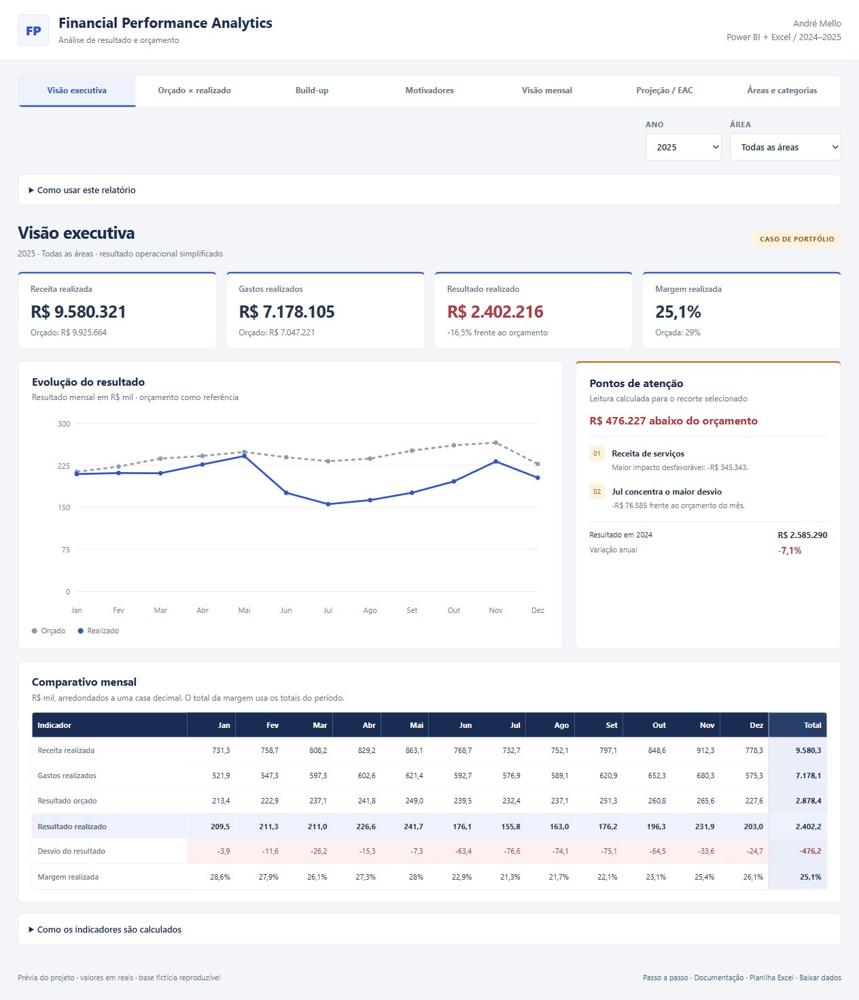
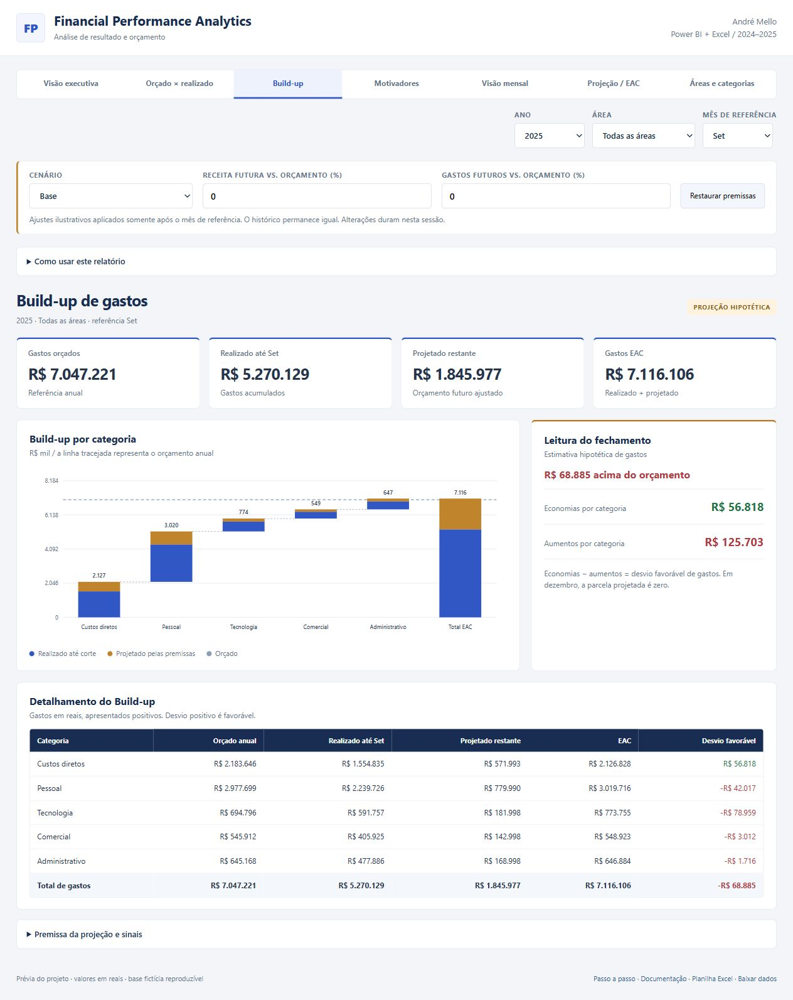
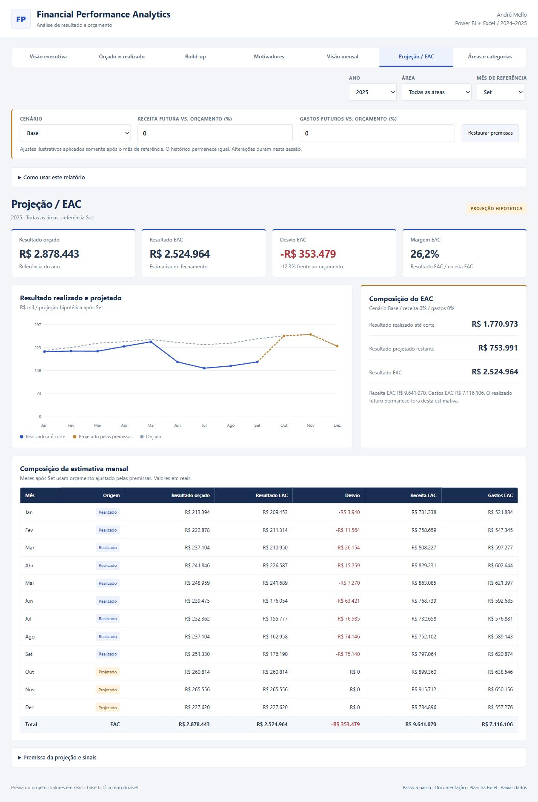

# Financial Performance Analytics

**Um caso de análise financeira: do dado ao diagnóstico do resultado.**

Projeto de portfólio de [André Mello](https://github.com/andremellotech), com Power BI, Power Query, DAX, Excel e Python.

**Versão 1.0.0** · [Como usar](docs/user-guide.md) · [Guia no navegador](docs/user-guide.html) · [Baixar Excel](excel/FinancialPerformance.xlsx)

[Demonstração online — disponível após ativar Pages](https://andremellotech.github.io/financial-performance-analytics/). A publicação ainda depende do envio do repositório e da ativação do workflow.

> Dados inteiramente fictícios. A imagem é uma captura da prévia web desta entrega, não do Power BI Desktop. Para dados alterados, abra a prévia atualizada.

## A pergunta de negócio

**Onde o resultado ficou abaixo do planejado e quais fatores explicam o desvio?**

O caso representa uma empresa fictícia de serviços, com Analytics, Engenharia e Operações durante 2024 e 2025. O orçamento de 2025 prevê crescimento; o realizado simula menor receita em parte do ano e pressão de gastos.

O relatório organiza indicadores no topo, evolução mensal com pontos de atenção ao lado e comparação detalhada abaixo. A identidade visual é própria, com azul e âmbar. Nenhum dado ou elemento de identidade de empresa foi utilizado.

## Resultado do caso: 2025

| Indicador | Orçado | Realizado |
| :--- | ---: | ---: |
| Receita | R$ 9.925.664,00 | R$ 9.580.320,63 |
| Gastos | R$ 7.047.221,44 | R$ 7.178.105,01 |
| Resultado operacional simplificado | R$ 2.878.442,56 | R$ 2.402.215,62 |
| Margem | 29,0% | 25,1% |

O desvio do resultado foi **R$ -476.226,94 (-16,5%)**. A área de Engenharia teve o maior desvio desfavorável: R$ -299.083,71. A decomposição separa receita, gastos e compensações. Veja a [análise completa](docs/findings.md).

Veja também as [recomendações gerenciais](docs/management-actions.md): achados, hipóteses a investigar, dados necessários e ações sugeridas. São propostas sobre o caso fictício, sem economias ou decisões atribuídas a uma empresa real.

## Explore o projeto

- **Prévia navegável:** baixe o repositório e abra [preview/index.html](preview/index.html). As sete perspectivas e os filtros funcionam localmente, sem CDN ou servidor.
- **Power BI:** abra [FinancialPerformance.pbip](powerbi/FinancialPerformance.pbip) no Desktop e clique em **Atualizar** para carregar os dados embarcados. Consulte o [guia do Power BI](docs/powerbi-guide.md).
- **Excel:** abra [FinancialPerformance.xlsx](excel/FinancialPerformance.xlsx) e selecione ano em B3, área em E3 e mês em H3 na aba Painel. Os filtros alimentam Build-up e Projeção. Consulte o [guia do Excel](docs/excel-guide.md).
- **Dados:** [fatos financeiros](data/fact_finance.csv), [dicionário](docs/data-dictionary.md) e [premissas](docs/assumptions.md).

O GitHub apresenta o código do HTML. Para usar a prévia, abra o arquivo localmente ou publique pelo GitHub Pages conforme o [guia de publicação](docs/publish-guide.md).

## O que foi construído

| Camada | Entrega |
| :--- | :--- |
| Dados | 864 registros mensais e dimensões de calendário, área e categoria |
| Tratamento | Consultas Power Query com validação de cobertura, chaves, cenários e sinais |
| Modelo | Cinco tabelas, três relações e 36 medidas DAX; corte mensal independente |
| Relatório | Sete páginas: Executiva, Orçado × realizado, Build-up, Motivadores, Mensal, Projeção/EAC e Áreas |
| Excel | Painel, Build-up, Projeção e Base, com fórmulas, três controles e quatro gráficos |
| Automação | Gerador determinístico, diagnósticos calculados e workflow de validação |

~~~mermaid
flowchart LR
    G[Gerador fictício] --> C[CSV validados]
    C --> M[Power Query e modelo]
    M --> P[Power BI]
    C --> E[Excel]
    C --> W[Prévia navegável]
~~~

O modelo usa PBIP, TMDL e PBIR para manter tabelas, medidas, páginas e visuais em arquivos legíveis para revisão no GitHub. Veja as [medidas DAX](powerbi/measures.dax) e [consultas M](powerbi/queries/).

## Build-up e projeção de fechamento

Ver o Build-up da prévia

O Build-up compõe os gastos por categoria e separa realizado até o corte e projeção restante. A aba Motivadores organiza economias e aumentos de gastos, com a receita separada para conciliar o desvio do resultado. A Visão mensal mostra o mês escolhido e o acumulado de janeiro até ele.

**EAC hipotético = realizado até o mês de referência + orçamento dos meses seguintes.** Valores realizados após o corte não entram na estimativa. A referência inicial é setembro, e o seletor permite qualquer mês do ano. Em dezembro, a parcela projetada é zero e o EAC corresponde ao realizado anual.

No exemplo de 2025 com corte em setembro, o resultado EAC é **R$ 2.524.963,98**, contra R$ 2.878.442,56 orçados. Os gastos EAC são R$ 7.116.106,45. Os gastos EAC ficam R$ 68.885,01 acima do orçamento. Isso é uma simulação de fechamento, distinta da análise do realizado anual acima.

Ver a projeção de fechamento

Carryover, risco de não execução, compromissos de contratos e revisão manual de forecast não são estimados por esta base. As explicações dos motivadores descrevem as premissas fictícias, sem atribuir causalidade a dados corporativos.

## Cenários editáveis

Na prévia e no Excel, Base, Otimista e Conservativo selecionam premissas de receita e gastos dos meses após o corte. O histórico permanece igual. Os valores iniciais são ilustrativos e podem ser editados:

| Cenário | Receita futura vs. orçamento | Gastos futuros vs. orçamento |
| :--- | ---: | ---: |
| Base | 0% | 0% |
| Otimista | +5% | −3% |
| Conservativo | −5% | +3% |

**EAC com cenário = realizado até o corte + orçamento futuro ajustado pelas premissas.** A projeção é arredondada por categoria/mês ao centavo antes dos totais. O Power BI mantém o EAC Base, sem os campos de ajuste de cenário. Consulte o [passo a passo](docs/user-guide.md) para localizar os controles e restaurar as premissas.

## Regras financeiras

Receitas são positivas; custos e despesas são negativos na base. O resultado é a soma dos valores. O indicador de gastos exibe sua magnitude positiva.

- Desvio do resultado = realizado − orçado; positivo é favorável.
- Desvio percentual = desvio / resultado orçado absoluto.
- Margem = resultado / receita no mesmo período e área.
- Comparação anual = realizado do ano anterior, com a mesma área.
- Sem denominador ou comparável, o indicador fica vazio, representado por — na prévia.

Não há impostos, resultado financeiro, depreciação ou integração com SAP nesta versão.

## Reproduza e valide

Python 3.11+, Node.js 24 para os testes da prévia e Power BI Desktop recente para editar o relatório.

~~~sh
python -m pip install -r scripts/requirements.txt
python scripts/generate_data.py
python scripts/validate_data.py
python scripts/build_powerbi.py
python scripts/validate_powerbi.py
python scripts/build_preview.py
python scripts/build_docs.py
python -m unittest discover -s tests
node tests/test_preview.js
node tests/test_scenarios.js
~~~

A semente 42 reproduz a mesma base. O workflow roda os testes e verifica divergências nos materiais gerados. A planilha não é reconstruída pelos comandos Python: atualize a Base conforme o guia do Excel.

Para reconstruir a partir de CSV já editados, execute **python scripts/build_all.py**. Esse comando preserva os CSV e renova o projeto, a prévia e os textos. O gerador de dados é uma ação separada que restaura a simulação original. As capturas do README são imagens desta entrega e não são renovadas pelo workflow.

## Verificação da entrega

Cálculos Python, JavaScript e Excel reconciliados nos oito filtros anuais e nos 96 recortes de EAC por ano/área/mês. Os resumos mensal e acumulado também reconciliam. JSON Power BI validado contra esquemas Microsoft; modelo TMDL aceito pelo parser oficial. Consulte a [verificação da entrega](docs/verification.md).

Os três cenários iniciais foram comparados em 288 recortes de ano/área/mês. Consulte também a [validação nos aplicativos](docs/native-validation.md), o [histórico de versões](CHANGELOG.md) e as [notas para publicar v1.0.0](docs/release-notes.md). A versão identifica o pacote local; a Release no GitHub ainda não foi publicada.

**Abertura visual, execução DAX e atualização M no Power BI Desktop ainda precisam de validação no aplicativo.** Validação de arquivos não confirma a renderização nativa. A planilha também não foi aberta no Microsoft Excel.

## Autor e licença

[André Mello](https://www.linkedin.com/in/aamello/) · [GitHub](https://github.com/andremellotech)

Código e dados fictícios sob [MIT](LICENSE). Os esquemas Microsoft mantêm a [licença de origem](docs/schemas/LICENSE).
